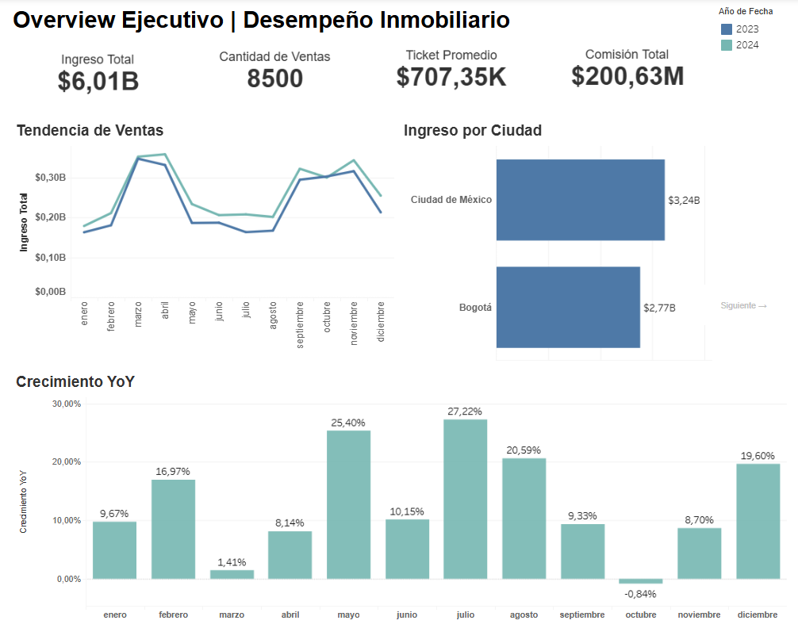
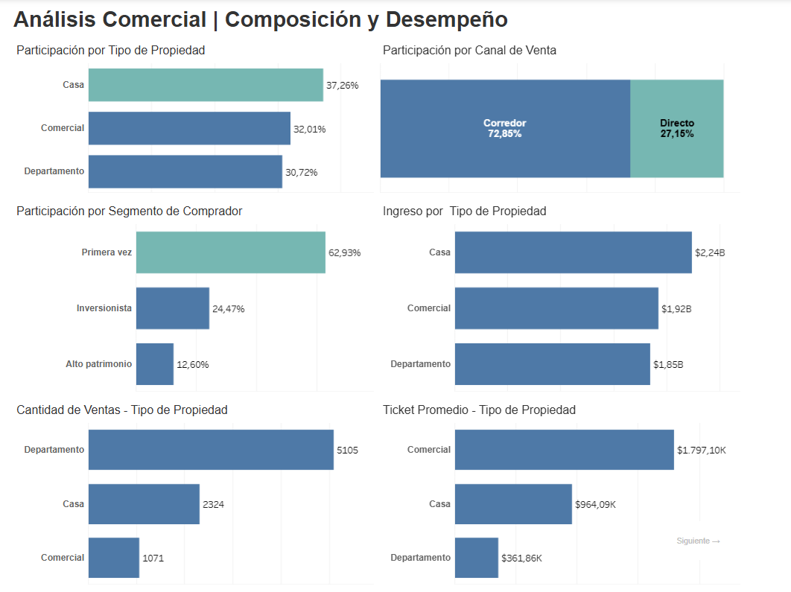
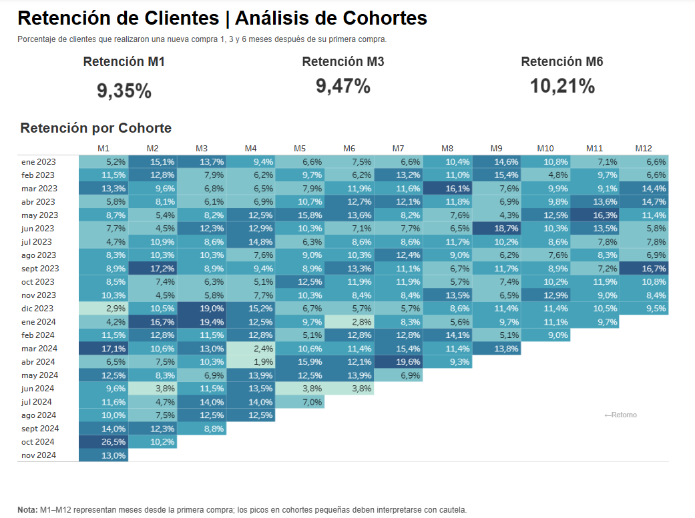

# Real Estate Sales & Customer Retention Analysis

**Tableau Public · Business Intelligence · Data Modeling · Sales Analytics · Cohort Retention**

## Project Overview

This business intelligence project evaluates real estate sales performance and customer purchasing behavior across **Mexico City and Bogotá** from **January 2023 through December 2024**. It combines property transactions, customer segments, and property attributes to support commercial performance monitoring and data-driven decision-making.

The analysis addresses revenue generation, sales volume, average transaction value, commissions, property mix, sales-channel contribution, year-over-year (YoY) performance, and repeat-purchase activity across customer cohorts.

**[Explore the Interactive Tableau Dashboard](https://public.tableau.com/app/profile/clara.herrera5092/viz/RealEstateSalesCustomerRetentionAnalysis/Dashboard1-OverviewEjecutivo)**

> **Project context:** Developed as an academic business intelligence project during the TripleTen Data Analytics program. The analysis and recommendations describe the supplied project dataset, not verified results from a live real estate business.

## Business Questions

- How much revenue and commission income did property sales generate?
- How did sales evolve over time, and what were the YoY changes?
- Which cities, property types, sales channels, and customer segments contributed most to revenue?
- How do sales volume and average transaction value differ across property types?
- How frequently do customers make subsequent purchases at the M1, M3, and M6 cohort checkpoints?

## Key Performance Indicators

| KPI | Result |
| --- | ---: |
| Total sales revenue | **$6,012,502,170 USD** |
| Property sales | **8,500** |
| Average sale value | **~$707,353 USD** |
| Total commissions | **$200,627,166 USD** |
| Analysis period | **2023–2024** |

*Revenue reflects recorded property sale prices. Commissions are reported separately; neither measure should be interpreted as net profit.*

## Data Sources & Model

Three original CSV files support the analysis:

| Dataset | Role | Rows |
| --- | --- | ---: |
| `hecho_ventas_propiedades.csv` | Fact table containing property sale transactions, dates, sale prices, customer/property IDs, sales channels, and commission fields | 8,500 |
| `dim_clientes.csv` | Customer attributes and buyer segmentation | 3,500 |
| `dim_propiedades.csv` | Property attributes, including property type, location, size, and listed price | 8,000 |

The logical analytical model connects the sales fact table to the customer and property dimensions through their corresponding identifiers. Tableau's native date capabilities were used for time-based analysis; a separate calendar CSV was not required.

### Data Preparation

- Reviewed data types and configured transaction dates as dates, numeric fields as numbers, and commission percentages as percentages.
- Checked missing values and primary-key uniqueness before analysis.
- Confirmed that no deletion or imputation was required in the documented preparation process.
- Developed the reporting views using the prepared transaction and dimension data.

## Tableau Dashboard

The published Tableau Public project contains **three interactive dashboard pages**. Their original Spanish titles are preserved below to match the live report; the descriptions are in English for international readers.

**[Explore the Interactive Tableau Dashboard](https://public.tableau.com/app/profile/clara.herrera5092/viz/RealEstateSalesCustomerRetentionAnalysis/Dashboard1-OverviewEjecutivo)**

### 1. Overview Ejecutivo | Desempeño Inmobiliario

**Executive Overview | Real Estate Performance**

This page summarizes total revenue, number of sales, average sale value, and total commissions. It also compares monthly sales trends for 2023 and 2024, revenue by city, and monthly year-over-year (YoY) revenue growth. The year filter supports period-specific exploration.



*Figure 1. Executive Overview — Real Estate Performance (Tableau Public).*

**Business value:** Helps stakeholders monitor overall commercial results, compare cities, and identify months that warrant further investigation.

### 2. Análisis Comercial | Composición y Desempeño

**Commercial Analysis | Composition & Performance**

This page examines revenue share by property type, sales channel, and buyer segment, alongside total revenue, number of sales, and average sale value by property type. It highlights differences between high-volume and high-value property categories.



*Figure 2. Commercial Analysis — Composition & Performance (Tableau Public).*

**Business value:** Supports evaluation of the sales mix, channel concentration, and the contribution of different property types and customer segments.

### 3. Retención de Clientes | Análisis de Cohortes

**Customer Retention | Cohort Analysis**

This page reports **M1 retention of 9.35%**, **M3 retention of 9.47%**, and **M6 retention of 10.21%**, together with a monthly acquisition-cohort heatmap displaying M1–M12 repeat-purchase percentages where the observation window permits.

The dashboard describes retention as the percentage of customers who made another purchase at the specified number of months after their first purchase. These are **checkpoint repeat-purchase rates**, not cumulative customer survival rates. High percentages in small cohorts require careful interpretation.



*Figure 3. Customer Retention — Cohort Analysis (Tableau Public).*

**Business value:** Makes repeat-purchase patterns visible by acquisition cohort and helps identify segments or periods for further investigation and targeted follow-up testing.

> **Interactive access:** The screenshots document the published dashboards, while the [Tableau Public report](https://public.tableau.com/app/profile/clara.herrera5092/viz/RealEstateSalesCustomerRetentionAnalysis/Dashboard1-OverviewEjecutivo) allows visitors to explore the live interactive visualization.

## Key Findings

### 1. Revenue Concentration by City

**Mexico City** generated approximately **$3.24B USD**, compared with **$2.77B USD** in **Bogotá**. This difference highlights the importance of evaluating geographic performance rather than relying only on company-wide totals.

### 2. Property Mix: Revenue vs. Volume

**Houses** contributed the largest share of revenue (**37.26%**, approximately **$2.24B USD**), while **apartments** accounted for the most transactions (**5,105 sales; 60.06%**). **Commercial properties** had the highest average sale value at approximately **$1.80M USD**.

**Business implication:** Sales volume and revenue contribution should be assessed together when prioritizing property segments.

### 3. Dependence on Broker-Led Sales

The **Broker (`Corredor`)** channel contributed **72.85% of revenue**, versus **27.15%** from the **Direct (`Directo`)** channel.

**Business implication:** Brokers are central to commercial performance, but the revenue mix suggests an opportunity to evaluate channel diversification.

### 4. First-Time Buyers Drive Revenue

**First-time buyers (`Primera vez`)** represented **62.93% of revenue**, followed by **Investors (`Inversionistas`)** at **24.47%** and **High-net-worth buyers (`Alto patrimonio`)** at **12.60%**.

**Business implication:** First-time buyers are an important audience for post-sale engagement and potential repeat-purchase strategies.

### 5. Year-over-Year Sales Patterns

YoY growth was positive in most months. The largest reported increases occurred in **July (+27.22%)** and **May (+25.40%)**, while **October (−0.84%)** was the only month with a negative YoY change.

**Business implication:** Month-level comparisons can help identify periods for deeper investigation, but they do not establish the causes of growth or decline.

### 6. Cohort Retention

The dashboard reports repeat-purchase checkpoints of **9.35% at M1**, **9.47% at M3**, and **10.21% at M6**. Its cohort heatmap additionally displays monthly M1–M12 observations where available.

**Business implication:** These cohort results suggest an opportunity to evaluate post-sale communication and repeat-purchase initiatives. Checkpoint percentages should not be interpreted as cumulative retention or causal effects of existing marketing activity.

## Business Recommendations

1. **Develop post-sale engagement strategies for first-time buyers.** Segment customers and test targeted follow-up campaigns to evaluate whether repeat purchasing improves.
2. **Balance property-type priorities.** Monitor houses for revenue contribution, apartments for transaction volume, and commercial properties for higher-value transactions.
3. **Review sales-channel concentration.** Maintain effective broker relationships while assessing opportunities to expand direct sales and reduce dependency on intermediaries.
4. **Investigate monthly YoY differences.** Examine the commercial context of May, July, and October before replicating tactics or attributing changes to particular causes.
5. **Monitor cohort outcomes.** Track M1, M3, and M6 activity consistently and evaluate retention initiatives with defined comparison groups and success metrics.

*These are analytical recommendations, not interventions claimed to have been implemented or proven effective.*

## Project Structure

```text

real-estate-sales-customer-retention/
├── README.md
├── data/
│   ├── hecho_ventas_propiedades.csv
│   ├── dim_clientes.csv
│   └── dim_propiedades.csv
├── docs/
│   └── methodology_and_findings.md
└── images/
    ├── executive_overview.png
    ├── commercial_analysis.png
    └── customer_retention.png

```
The `images/` folder contains screenshots of the three Tableau dashboards, while the `docs/` folder provides detailed documentation of the analytical methodology, KPI definitions, findings, and business recommendations.
## Detailed Methodology & Findings

For a deeper understanding of the analytical workflow, data preparation, KPI definitions, Tableau dashboard development, key findings, business recommendations, and limitations, explore the supporting documentation.

📄 **[View Detailed Methodology & Findings](docs/methodology_and_findings.md)**

## Tools & Skills

- **Tableau Public:** Interactive dashboards, calculated fields, time-series comparisons, and cohort visualization.
- **Data modeling:** Transaction fact table linked to customer and property dimensions.
- **Data validation:** Data types, null checks, and primary-key validation.
- **Business analytics:** Sales KPIs, segmentation, channel contribution, YoY analysis, and retention interpretation.
- **Executive communication:** Findings, business implications, and actionable recommendations.

## Limitations & Interpretation

- This is an academic dataset and should not be represented as live company performance.
- Recorded sale prices and commissions do not establish business profitability or net income.
- Observed associations and monthly trends do not establish causation.
- Cohort checkpoint rates describe the documented retention measures; interpreting them requires attention to the underlying cohort definitions and observation windows.

## Author

**Clara Herrera**  
Data Analytics Portfolio · Tableau & Business Intelligence
